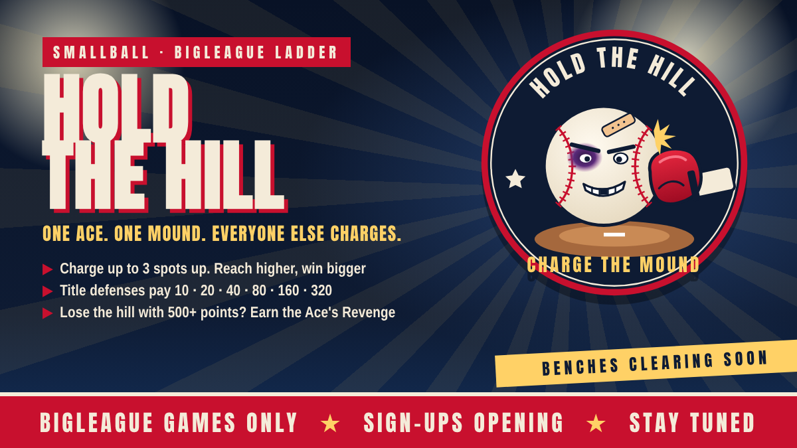

# ⛰️ Hold the Hill

A King-of-the-Hill BigLeague ladder for SmallBall, run from a Google Sheet, a Google Form and Apps Script,
with Discord webhooks and a live Hill Board web page. **Join:** https://discord.gg/DH6KxXHgR

## How it plays
- 🧗 One club per owner on a single ladder, the Climb.
- 🥊 Charge up to 3 spots above you (2 up = win by 3+, 3 up = win by 4+). Underdogs win by less (1 run off per star behind).
- 👑 #1 gets the title shot at **the Ace**. The mound opens one more spot each day nobody charges, down to #5.
- 📡 Games are found from SmallBall's public game list and results post only after they air (no spoilers).
- 🏆 Daily Brawl points by ladder spot go toward **The Bench Clearer Cup**, plus season awards.
- 🎰 A play-money sportsbook (Brawl Bucks) with matchup lines and Ace futures.
- 🛒 Brawl Bucks items: 🥊 Brass Knuckles (+1 run on the next charge against you), 🧽 Margin Eraser (any win will do), 🪜 Ladder Jump (charge one spot past your reach), 🪜 Ladder Jump+ (the same, and any win will do), 🌧️ Rain Delay (saves your streak once). The Ace pays 2×. Every Hill game pays Brawl Bucks too. Turn it on from the menu: **🛒 Add the Brawl Bucks items shop to the form**.
- 🔥 Hill streaks: every day you play a Hill game pays Brawl Bucks, growing each day in a row, with milestone bonuses (3, 5, 7, 10, 14, 21, 30 days). Challengers get a bonus for every charge that gets played.

Rules images: [1](art/HoldTheHill-rules-1.png) · [2](art/HoldTheHill-rules-2.png) · [3](art/HoldTheHill-rules-3.png) · [4](art/HoldTheHill-rules-4.png)

## Run your own
1. Make a new Google Sheet → **Extensions → Apps Script**, paste `HoldTheHill.gs`, Save.
2. Run `setup` once (approve the permissions). It builds the tabs, the Form and the triggers, and adds a **Hold the Hill** menu.
3. Fill in the **Config** tab: Discord webhook URLs (feed, sportsbook, trash talk, help, log), season dates and the rest. Webhook URLs are secrets: they live only in your Sheet, never in this file.
4. **Deploy → New deployment → Web app** (execute as you, anyone can access) for the Hill Board. Add `?demo=1` to the link to see sample data.
5. After pasting a new version of the script, **Deploy → Manage deployments → ✏️ → New version** so the Hill Board picks it up.

Read-only on SmallBall: it reads public game lists and never plays or saves anything.
