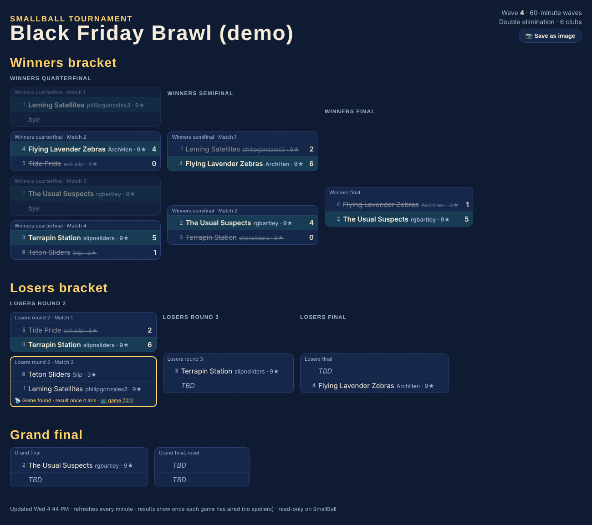

# 🏆 SmallBall Tournament (script)

A Google Sheet + Form + Apps Script that runs a SmallBall tournament **on its own**, even when the organizer is away:

- **Sign-ups** on a Google Form it makes for you. Bad entries get a red ❌ in Discord with the reason.
- **Returning players sign up with a blank form:** the form knows them by their Google sign-in and fills in their Discord, ID, owner name, club and stars from last time (or from your Hold the Hill sheet).
- **The bracket** is drawn when sign-ups close: double or single elimination, seeded by sign-up order, stars or a random draw.
- **Waves:** matches open at fixed times (every 60 minutes by default) and owners get @tagged with their opponent's club ID.
- **Results find themselves:** the script reads SmallBall's public game list every minute, finds the game between the two clubs, and posts the result **once the game has aired** (no spoilers), with a watch link while it airs.
- **No-shows and ties** are handled automatically (higher seed moves on; ties replay), so the tournament never stalls.
- **A live bracket page** anyone can open, with a 📷 *Save as image* button for posting the bracket.
- **The organizer's menu:** settle or undo a match, draw early, post the bracket, test the webhook.

## Run one
1. Make a new Google Sheet → **Extensions → Apps Script**, paste [`SmallBallTournament.gs`](SmallBallTournament.gs), Save.
2. Run **setup** once and approve. It makes the sign-up form, the tabs, the triggers and a 🏆 Tournament menu.
3. In **Config**: paste a Discord webhook URL, set `TOURNEY_NAME`, `SIGNUP_CLOSE`, `START` and `WAVE_MINUTES`.
4. **Deploy → New deployment → Web app** (Execute as: Me · Who has access: Anyone) for the live bracket. Add `?demo=1` to see sample data.
5. Share the form link. That's it.

Read-only on SmallBall: it never plays, trains or saves anything there.
